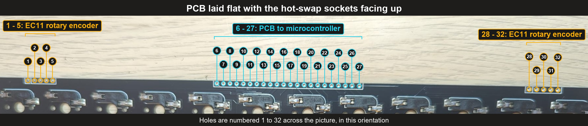
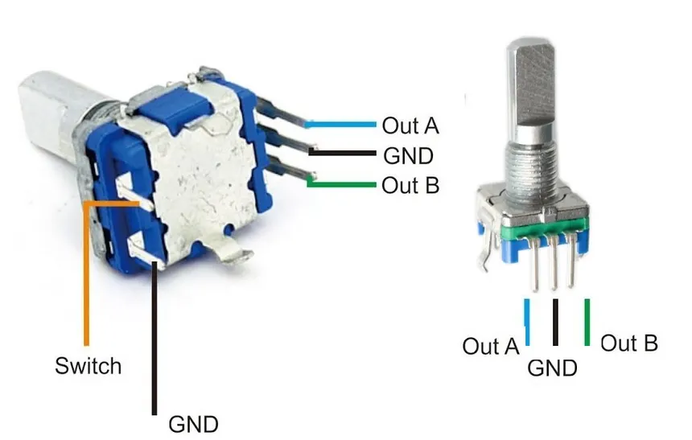

# Micro Journal Rev.2.1.mini: Baby Shark - Build Guide

Build video: [https://youtu.be/kK5mviicKP4](https://youtu.be/kK5mviicKP4)

## Bill of Materials

The parts are the same as the [Micro Journal Rev.2.1](../2.1/build.md). The only difference is the keyboard PCB: the Rev.2.1.mini uses the 48 keys PCB instead of the 68 keys PCB.

Most components are readily available from platforms such as Amazon or AliExpress. One component that may be slightly more difficult to source is the [48 keys keyboard PCB](https://www.elecrow.com/micro-journal-diy-kit-48-keys-keyboard-pcb.html). You can purchase it directly from the supplier, even in small quantities. You can also order it from a PCB assembly service using the files in [shared/keyboard-48](../../shared/keyboard-48/readme.md).

| # | Part | Qty |
|---|------|-----|
| 1 | [Wisecoco 7.84" 1280x400 LCD Display](https://www.amazon.com/wisecoco-Secondary-Stretched-Temperature-Monitoring/dp/B0BXL2Q53Y) | 1 |
| 2 | [Rubber O-ring OD 18 ID 13.2 CS 2.4mm](https://www.amazon.com/uxcell-Rings-Nitrile-Rubber-Diameter/dp/B07JHNDXCX) | 1 |
| 3 | [HDMI Cable 25cm](https://www.amazon.com/UVOOI-HDMI-Cable/dp/B0B5JM7Y4G) | 1 |
| 4 | [Raspberry Pi Zero 2W](https://www.amazon.com/Raspberry-Zero-Bluetooth-RPi-2W/dp/B09LH5SBPS) | 1 |
| 5 | [Raspberry Pi Pico (RP2040)](https://www.amazon.com/Raspberry-Pi-Pico/dp/B09KVB8LVR) | 1 |
| 6 | [Micro SD Card (min 8GB)](https://www.amazon.com/SanDisk-microSD-High-Capacity-microSDHC/dp/B00488G6P8) | 1 |
| 7 | [48 Keys Keyboard PCB](https://www.elecrow.com/micro-journal-diy-kit-48-keys-keyboard-pcb.html) | 1 |
| 8 | [EC11 15mm Half Handle Rotary Encoder](https://www.amazon.com/Position-Degree-Rotary-Encoder-Button/dp/B0GRNSTXFC) | 2 |
| 9 | [18650 Battery Shield w/ 4-Slot Holder](https://www.amazon.com/diymore-Battery-Holder-Charging-Holders/dp/B0CBMQ8PZH) | 1 |
| 10 | Micro USB Hub with Power Input | 1 |
| 11 | [Micro USB 2-PIN Male Pigtail Cable](https://www.amazon.com/Jienk-Micro-Male-Pigtail-Cable/dp/B0D9LJ1J4R) | 2 |
| 12 | [USB 2-PIN Male Cable](https://www.amazon.com/Jienk-Micro-Male-Pigtail-Cable/dp/B0D9LJ1J4R) | 1 |
| 13 | [SPST Snap-in Rocker Switch 2-Pin 19mm](https://www.amazon.com/YXQ-SPST-Rocker-Switch-5Pieces/dp/B01DZ8BHBE) | 1 |
| 14 | [DIN 912 M3 Hex Socket Screw — 5mm](https://www.amazon.com/M3-3mm-0-50-Stainless-MonsterBolts/dp/B078L44PWY) | 4+ |
| 15 | [DIN 912 M3 Hex Socket Screw — 10mm](https://www.amazon.com/Socket-Screw-M3-0-5-Metric-Quantity/dp/B07CPMTDPV) | 4+ |
| 16 | [DIN 912 M3 Hex Socket Screw — 50mm](https://www.amazon.com/Socket-Screw-M3-0-5-Metric-Quantity/dp/B07CPGYJHG) | 4+ |
| 17 | [DIN 7046 M2 Phillips Pan Head Screw — 5mm](https://www.amazon.com/M2-0-4X10-Metric-Phillips-Machine-Thread/dp/B01ILZX2VO) | 8+ |
| 18 | [M3 Heated Inserts (OD 4.5mm, L 3mm)](https://www.amazon.com/Threaded-Inserts-Embedment-Printing-Automotive/dp/B0CH32W3W5) | 10+ |
| 19 | [M2 Heated Inserts (OD 3.2mm, L 3mm)](https://www.amazon.com/uxcell-Knurled-Threaded-Insert-Embedment/dp/B07LBRL93N) | 10+ |
| 20 | [TORX T10H Screwdriver](https://www.amazon.com/Torx-Screwdriver-Security-security-Screws/dp/B093DTBMNN) | 1 |
| 21 | [Wires 30 AWG (assorted)](https://www.amazon.com/JESSINIE-8-Color-Electronic-DM-30-1000-Wrapping/dp/B0BJ86D1Q3) | 1 |
| 22 | PLA+ Filament (for 3D-printed enclosure) | 1 |

You will also need 48 Cherry MX compatible switches and 48 keycaps (see [Keyboard parts](#1-keyboard-parts)).

The same parts on AliExpress:

- [Wisecoco 7.84 Inch 1280x400 LCD Display](https://www.aliexpress.com/item/1005004986951553.html)
- [Rubber O-ring 18x13.2x2.4mm](https://www.aliexpress.com/item/1005002753756030.html)
- [HDMI Cable 25 cm](https://www.aliexpress.com/item/1005007721692972.html)
- 2x [EC11 15mm Half handle](https://it.aliexpress.com/item/1005005983134515.html)
- [18650 Lithium Battery Shield with 4 Battery Holder](https://www.aliexpress.com/item/1005007581124399.html)
- [Micro USB Hub with Power Input](https://www.aliexpress.com/item/1005006750076510.html)
- [2x Micro USB 2 PIN Male Cable](https://www.aliexpress.com/item/1005008243661710.html)
- [USB 2 PIN Male Cable](https://www.aliexpress.com/item/1005008243661710.html)
- [Wires 30 AWG](https://it.aliexpress.com/item/1005007081117235.html)

## Table of Contents

1. Keyboard parts
2. Keyboard PCB
3. Wiring the PCB to the Raspberry Pi Pico
4. Keyboard firmware
5. Rest of the build

## 1. Keyboard parts

* Raspberry Pi Pico (RP2040)
* Keyboard PCB - 48 keys (see [keyboard-48](../../shared/keyboard-48/readme.md))
* 2x EC11 rotary encoders, 15mm half handle, for the knobs
* 48 Cherry MX compatible keyboard switches (3-pin or 5-pin)
* 48 keycaps. XDA or MOA keycaps are recommended.

You will also need:

* A soldering iron and solder
* Thin electronics wire. 30 AWG works well.

## 2. Keyboard PCB

The keyboard uses the 48 key PCB. Its design files, the list of parts and the description of its connection holes are in [shared/keyboard-48](../../shared/keyboard-48/readme.md).

The keyboard is built and wired exactly the same way as on the [Micro Journal Rev.3 build guide](../../rev.3/3.0.revamp/build.md), and it runs the same pin layout.

The hot-swap sockets accept Cherry MX compatible switches, so no soldering is needed for the switches themselves. Install the switches after the PCB is mounted in the enclosure.

Hold the PCB with the hot-swap sockets facing up. Along the top edge there are 32 numbered connection holes:

| Holes   | Used for                                       |
| ------- | ---------------------------------------------- |
| 1 - 5   | Right EC11 rotary encoder                      |
| 6 - 27  | PCB to microcontroller (the Raspberry Pi Pico) |
| 28 - 32 | Left EC11 rotary encoder                       |

## 3. Wiring the PCB to the Raspberry Pi Pico

Holes 6 to 27 are the 22-pin connection to the microcontroller. Solder one wire from each of these holes to the matching pin of the Raspberry Pi Pico. Solder the wires on the side where the hot-swap sockets are.

Use the table below. The "Signal" column comes from the PCB schematic, and the GPIO numbers come from the keyboard firmware ([keyboard.json](./keyboard/qmk-vial/keyboard.json)).

| PCB hole | Signal       | Pico GPIO |
| -------- | ------------ | --------- |
| 6        | row 1        | GP2       |
| 7        | row 2        | GP3       |
| 8        | row 3        | GP4       |
| 9        | row 4        | GP5       |
| 10       | col 1        | GP6       |
| 11       | col 2        | GP7       |
| 12       | col 3        | GP8       |
| 13       | col 4        | GP9       |
| 14       | col 5        | GP10      |
| 15       | col 6        | GP11      |
| 16       | col 7        | GP12      |
| 17       | col 8        | GP13      |
| 18       | col 9        | GP14      |
| 19       | col 10       | GP15      |
| 20       | col 11       | GP16      |
| 21       | col 12       | GP17      |
| 22       | row 5        | GP18      |
| 23       | left knob 1  | GP19      |
| 24       | left knob 2  | GP20      |
| 25       | right knob 1 | GP21      |
| 26       | right knob 2 | GP22      |
| 27       | GND          | GND       |

Notes on the table:

* Hole 6 is the first of the 22 holes, as numbered in the picture above. The connector on the schematic is numbered 1 to 22, so hole number = connector pin + 5.
* If an encoder turns in the wrong direction, swap its two wires (holes 23 and 24, or holes 25 and 26), or swap the direction in Vial.

### Wiring the EC11 rotary encoders

The EC11 has five legs. Three legs on one side are for the rotation: **Out A**, **GND** (the middle one) and **Out B**. The two legs on the other side are for the push button (**Switch**).

Solder one wire from each leg to the matching hole of the PCB. The **right** encoder uses holes 1 to 5 and the **left** encoder uses holes 28 to 32. The first hole of each group is the square one.

| Right encoder hole | Left encoder hole | EC11 leg                                    | PCB signal                                                 |
| ------------------ | ----------------- | ------------------------------------------- | ---------------------------------------------------------- |
| 1                  | 28                | Out B                                       | Knob 2 (right: GP22, left: GP20)                           |
| 2                  | 29                | GND (middle leg)                            | GND                                                        |
| 3                  | 30                | Out A                                       | Knob 1 (right: GP21, left: GP19)                           |
| 4                  | 31                | Switch (either of the two push button legs) | Push button, connected to col 5 through a diode on the PCB |
| 5                  | 32                | Switch (the other push button leg)          | Push button, connected to a row line on the PCB            |

Tips:

* The push button works the same way whichever of its two legs goes to hole 4 or hole 5 (hole 31 or hole 32 for the left encoder).
* In the picture, the second push button leg is also labeled GND. On this PCB it is **not** ground. It goes to the keyboard matrix like the other push button leg.
* Use a different color wire for the GND leg, so it is easy to identify.
* The rotation signals reach the Pico through holes 23 and 24 (left knob) and holes 25 and 26 (right knob).
* If a knob turns in the wrong direction, swap its Out A and Out B wires (holes 3 and 1 for the right knob, or holes 30 and 28 for the left knob).

## 4. Keyboard firmware

The keyboard runs QMK with Vial. The source code is in the [keyboard/qmk-vial](./keyboard/qmk-vial) folder.

1. Hold the **BOOTSEL** button on the Raspberry Pi Pico and connect it to your computer with a USB cable. It appears as a drive named `RPI-RP2`.
2. Copy [unkyulee_ortho_48_vial.uf2](./keyboard/unkyulee_ortho_48_vial.uf2) onto that drive.
3. The Pico restarts by itself and is now a keyboard.

If you want to build the firmware yourself, set up the QMK build environment, then follow the instructions in the [keyboard readme](./keyboard/qmk-vial/readme.md).

To change the keys, use Vial: [https://get.vial.today/](https://get.vial.today/)

## 5. Rest of the build

Once the keyboard is built, the rest of the internal build is almost the same as the Micro Journal Rev.2.1. Until the dedicated build guide for the Rev.2.1.mini comes online, please refer to the Rev.2.1 build video and build guide:

* [Rev.2.1 build video](https://youtu.be/-GmhE2VCncA)
* [Rev.2.1 build guide](../2.1/build.md)
