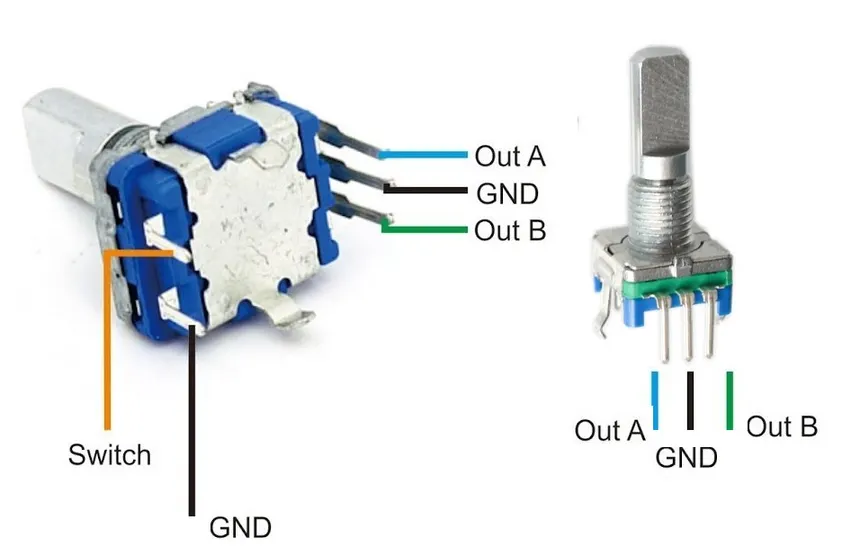
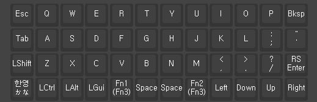
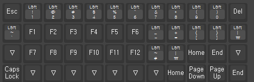
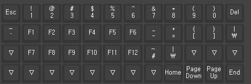

# Micro Journal Rev.3: Nadia - Build Guide

Build video: [https://youtu.be/kK5mviicKP4](https://youtu.be/kK5mviicKP4)

Rev.3 Nadia is a 48-key mechanical keyboard that sits next to a phone or tablet. A Raspberry Pi Pico inside the keyboard makes it appear as a standard USB keyboard on your PC or phone.

## Table of Contents

1. Parts and tools
2. 3D printed parts
3. Keyboard PCB
4. Wiring the PCB to the Raspberry Pi Pico
5. Firmware
6. Enclosure assembly
7. Using the keyboard

## 1. Parts and tools

* 3D printed parts
* Raspberry Pi Pico (RP2040)
* Keyboard PCB - 48 keys (see [keyboard-48](../../shared/keyboard-48/readme.md))
* 2x O-ring 18x13.2x2.4
* 2x EC11 rotary encoders, 15mm half handle, for the knobs

* DIN 912 M3 Hex Screw Length 10mm
* DIN 912 M3 Hex Screw Length 70mm
* DIN 7046 M2 Machine Screw Length 5mm
* M3 Heated Inserts OD 4.5mm Length 3mm
* M2 Heated Inserts OD 3.2mm Length 3mm

* 48 Cherry MX compatible keyboard switches (3-pin or 5-pin)
* 48 keycaps. XDA or MOA keycaps are recommended.

You will also need:

* A soldering iron and solder
* Thin electronics wire. 30 AWG works well.
* A USB-A to USB-C data cable (see the [user guide](./guide.md#cable-characteristics))

## 2. 3D printed parts

The design files are in the [STL](./STL) folder.

| File                                                                | Part                                      |
| ------------------------------------------------------------------- | ----------------------------------------- |
| `Enclosure Left.stl`, `Enclosure Middle.stl`, `Enclosure Right.stl` | The three sections of the enclosure       |
| `Keyboard Plate.stl`                                                | Plate that holds the switches             |
| `Display.stl`                                                       | Display panel                             |
| `Grill Right.stl`                                                   | Right grill                               |
| `USB Port.stl`                                                      | USB port part                             |
| `Knob.stl`                                                          | Knobs for the two rotary encoders         |
| `Label.stl`                                                         | Label                                     |
| `microjournal.rev.3.revamp.3mf`                                     | All parts in one print-ready project file |
| `Micro Journal Rev.3.f3d`                                           | Original Fusion 360 design                |

## 3. Keyboard PCB

The keyboard uses the 48 key PCB. Its design files, the list of parts and the description of its connection holes are in [shared/keyboard-48](../../shared/keyboard-48/readme.md).

The hot-swap sockets accept Cherry MX compatible switches, so no soldering is needed for the switches themselves. Install the switches after the PCB is mounted in the enclosure.

Hold the PCB with the hot-swap sockets facing up. Along the top edge there are 32 numbered connection holes:

| Holes   | Used for                                       |
| ------- | ---------------------------------------------- |
| 1 - 5   | Right EC11 rotary encoder                      |
| 6 - 27  | PCB to microcontroller (the Raspberry Pi Pico) |
| 28 - 32 | Left EC11 rotary encoder                       |

## 4. Wiring the PCB to the Raspberry Pi Pico

Holes 6 to 27 are the 22-pin connection to the microcontroller. Solder one wire from each of these holes to the matching pin of the Raspberry Pi Pico. Solder the wires on the side where the hot-swap sockets are.

Use the table below. The "Signal" column comes from the PCB schematic, and the GPIO numbers come from the keyboard firmware ([keyboard.json](./keyboard/keyboard.json)).

| PCB hole | Signal       | Pico GPIO |
| -------- | ------------ | --------- |
| 6        | row 1        | GP2       |
| 7        | row 2        | GP3       |
| 8        | row 3        | GP4       |
| 9        | row 4        | GP5       |
| 10       | col 1        | GP6       |
| 11       | col 2        | GP7       |
| 12       | col 3        | GP8       |
| 13       | col 4        | GP9       |
| 14       | col 5        | GP10      |
| 15       | col 6        | GP11      |
| 16       | col 7        | GP12      |
| 17       | col 8        | GP13      |
| 18       | col 9        | GP14      |
| 19       | col 10       | GP15      |
| 20       | col 11       | GP16      |
| 21       | col 12       | GP17      |
| 22       | row 5        | GP18      |
| 23       | left knob 1  | GP19      |
| 24       | left knob 2  | GP20      |
| 25       | right knob 1 | GP21      |
| 26       | right knob 2 | GP22      |
| 27       | GND          | GND       |

Notes on the table:

* Hole 6 is the first of the 22 holes, as numbered in the picture above. The connector on the schematic is numbered 1 to 22, so hole number = connector pin + 5.
* If an encoder turns in the wrong direction, swap its two wires (holes 23 and 24, or holes 25 and 26), or swap the direction in Vial.

### Wiring the EC11 rotary encoders

The EC11 has five legs. Three legs on one side are for the rotation: **Out A**, **GND** (the middle one) and **Out B**. The two legs on the other side are for the push button (**Switch**).

Solder one wire from each leg to the matching hole of the PCB. The **right** encoder uses holes 1 to 5 and the **left** encoder uses holes 28 to 32. The first hole of each group is the square one.

| Right encoder hole | Left encoder hole | EC11 leg                                    | PCB signal                                                 |
| ------------------ | ----------------- | ------------------------------------------- | ---------------------------------------------------------- |
| 1                  | 28                | Out B                                       | Knob 2 (right: GP22, left: GP20)                           |
| 2                  | 29                | GND (middle leg)                            | GND                                                        |
| 3                  | 30                | Out A                                       | Knob 1 (right: GP21, left: GP19)                           |
| 4                  | 31                | Switch (either of the two push button legs) | Push button, connected to col 5 through a diode on the PCB |
| 5                  | 32                | Switch (the other push button leg)          | Push button, connected to a row line on the PCB            |

Tips:

* The push button works the same way whichever of its two legs goes to hole 1 or hole 2.
* In the picture, the second push button leg is also labeled GND. On this PCB it is **not** ground. It goes to the keyboard matrix like the other push button leg.
* Use a different color wire for the GND leg, so it is easy to identify.
* The rotation signals reach the Pico through holes 23 and 24 (left knob) and holes 25 and 26 (right knob).
* If a knob turns in the wrong direction, swap its Out A and Out B wires (holes 3 and 5 for the right knob, or holes 30 and 32 for the left knob).

## 5. Firmware

The keyboard runs QMK with Vial. The source code is in the [keyboard](./keyboard) folder.

1. Hold the **BOOTSEL** button on the Raspberry Pi Pico and connect it to your computer with a USB cable. It appears as a drive named `RPI-RP2`.
2. Copy [unkyulee_vial.uf2](./keyboard/unkyulee_vial.uf2) onto that drive.
3. The Pico restarts by itself and is now a keyboard.

If you want to build the firmware yourself, set up the QMK build environment, then follow the instructions in the [keyboard readme](./keyboard/readme.md).

To change the keys, use Vial: [https://get.vial.today/](https://get.vial.today/)

The default layers are:

| Default                                     | Lower                                             | Raise                                             |
| ------------------------------------------- | ------------------------------------------------- | ------------------------------------------------- |
|  |  |  |

## 6. Enclosure assembly

* Please refer from the build video: [https://youtu.be/kK5mviicKP4](https://youtu.be/kK5mviicKP4)*

## 7. Using the keyboard

Please see the [Quick Start Guide](./guide.md) for how to connect the keyboard to a PC or phone.
