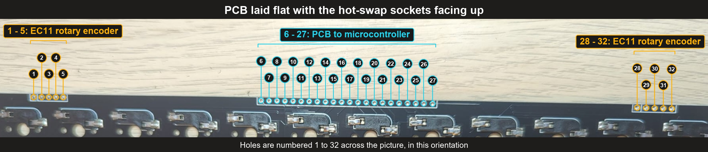

# 48 Keys Keyboard PCB

This folder contains the design files for the 48 keys mechanical keyboard PCB used by Micro Journal Rev.6.

## What Is in This Folder

| Folder | Contents |
| ------ | -------- |
| [GERBER](./GERBER) | The files a PCB manufacturer needs to produce the board: the Gerber files, the bill of materials (BOM) and the pick and place file |
| [DESIGN](./DESIGN) | The schematic of the PCB, for when you need to dive deeper into how the board works |

## How to Get the PCB

### Option 1: Order from a PCB Assembly Service

Upload the files in the [GERBER](./GERBER) folder to a PCB assembly (PCBA) service to order the board with the parts already soldered on.

| File | Used for |
| ---- | -------- |
| `Gerber_Mechanical-Keyboard-48-SMD_..._.zip` | Manufacturing the bare PCB |
| `BOM_Mechanical-Keyboard-48-SMD_..._.csv` | The list of parts to assemble |
| `PickAndPlace_PCB_Mechanical-Keyboard-48-..._.csv` | Where each part is placed on the board |

These services usually require a minimum order quantity, so you will end up with a few spare boards.

### Option 2: Order a Single Board

If you only need one board, you can order a single piece from the link below:

- [Micro Journal 48 Keys Keyboard PCB (Elecrow)](https://www.elecrow.com/micro-journal-diy-kit-48-keys-keyboard-pcb.html)

## Parts Used on the PCB

Only two parts are used in the build:

| Part | Part name | Footprint | Quantity |
| ---- | --------- | --------- | -------- |
| Hot-swappable switch socket | `CPG151101S11` Kailh hot-swap socket for Cherry MX compatible switches | `CHERRY-HOTSWAP-MOD` | 48 |
| Diode | `1N5819WS S4` Schottky diode (LCSC part `C2927280`) | SOD-323 | 50 |

The hot-swap sockets accept Cherry MX compatible (MX-style) switches, so switches can be installed and replaced without soldering.

## Connection Holes

The picture shows the PCB laid flat with the hot-swap sockets facing up. The connection holes are along the top edge, numbered 1 to 32 as they appear in this picture. The orientation flips once the PCB is installed, so always identify a hole by its number in this view.

| Holes | Used for |
| ----- | -------- |
| 1 - 5 | EC11 rotary encoder |
| 6 - 27 | PCB to microcontroller |
| 28 - 32 | EC11 rotary encoder |

## Design Files

The [DESIGN](./DESIGN) folder contains the schematic of the PCB as a PDF. You do not need it to order or build the keyboard. It is there in case you want to deep dive into the PCB, for example to trace the row and column matrix or to troubleshoot a key that does not respond.

## Build Guide

- [Micro Journal Rev.6: Vivian in New York - Build Guide](../../rev.6/6.0/build.md)
